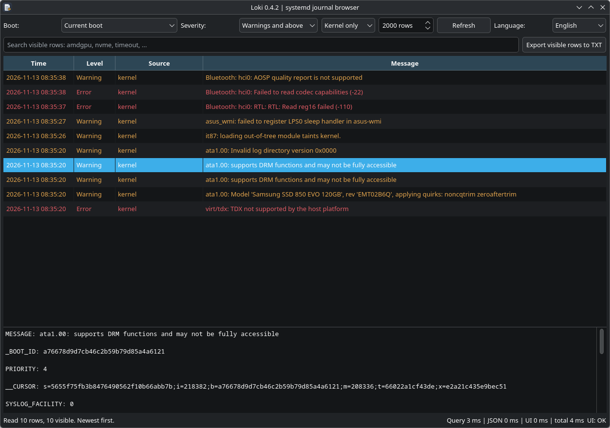

# Loki 0.4.2

## English

Loki is a read-only browser for the systemd journal, aimed at CachyOS with KDE
Plasma 6. It reads journal entries through `journalctl`; it does not edit or
delete system logs.

### Screenshot



### Features

- Browse the current boot, previous boot, or another boot listed by the system
  journal.
- Filter by severity and choose all sources or kernel messages only.
- Search loaded entries by timestamp, source, or message. Search is
  case-insensitive and applies to the entries already loaded.
- Set the maximum number of entries to load (100–20,000; default 2,000).
- Select a row to inspect its complete journal fields.
- Export the rows currently visible through the filters and search to a UTF-8
  text file.
- Use Finnish or English. Loki follows a Finnish system language and otherwise
  defaults to English. A language selected in the application is saved for the
  next launch.
- Refresh with the button or `F5`; focus search with `Ctrl+F`.

By default, Loki loads errors and more severe messages. Change the severity
control to include other priorities or all priorities.

### Requirements

- CachyOS or Arch Linux with KDE Plasma 6 (other Linux desktop environments
  may run Loki, but the launcher integration is designed for KDE).
- Python 3.
- PySide6, available on CachyOS/Arch Linux through the `pyside6` package.
- `journalctl`, provided by systemd.

Loki has no additional Python package dependencies. It does not require root
privileges to run. A regular user may not have permission to read every system
journal entry.

### Install

Install the PySide6 system package if it is not already available:

```sh
sudo pacman -S --needed pyside6
```

Extract the Loki release archive, open a terminal in the extracted directory,
and run the installer as your regular user:

```sh
python3 asennus.py
```

Do not run the installer with `sudo`. It installs the application, launcher,
icon, and KDE application-menu entry for the current user only. The installer
checks that PySide6 and `journalctl` are available. KDE's application cache is
refreshed when `kbuildsycoca6` is available.

By default, files are installed under:

- `~/.local/share/loki-journal/` — application and uninstaller
- `~/.local/share/applications/loki-journal.desktop` — KDE menu entry
- `~/.local/share/icons/hicolor/scalable/apps/loki-journal.svg` — icon
- `~/.local/bin/loki-journal` — command-line launcher

When `XDG_DATA_HOME` is set to an absolute path, the application, desktop entry,
and icon use that data directory. The command-line launcher remains under
`~/.local/bin/`.

### Update an existing installation

Extract the new release and run its installer from the extracted directory as
the same user:

```sh
python3 asennus.py
```

The installer replaces Loki's application files and refreshes the desktop
entry, launcher, and icon in their existing user-level locations. It recognizes
the previous Loki installation markers when removing an older install.

### Start Loki

- Search for **Loki** in the KDE application menu.
- Or run `~/.local/bin/loki-journal`.
- To run directly from the extracted release directory, use `python3 loki.py`.

### Uninstall

Run the installed uninstaller as the same regular user:

```sh
python3 ~/.local/share/loki-journal/asennus.py --uninstall
```

If you installed with an absolute `XDG_DATA_HOME`, use
`python3 "$XDG_DATA_HOME/loki-journal/asennus.py" --uninstall` instead. Loki's
uninstaller removes its recognized launcher, menu entry, icon, and application
files. It keeps unrecognized files in the application directory and does not
remove system journal entries or exported text files.

### Known limitations

- Loki can only display entries that the current user is allowed to read.
- Search covers the entries currently loaded, not the entire journal. Increase
  the row limit or change the boot and severity filters to inspect other data.
- Export contains only rows currently visible in the table.
- Loki is a journal viewer; it does not modify journal entries, configure
  system logging, or provide log-management actions.

Logs may contain personal or sensitive information. Review exported files
before sharing them.

### License

Loki is released under the [MIT License](LICENSE). Copyright (c) 2026 janipt.

## Suomi

Loki on vain luku -tilassa toimiva systemd-journalin selainsovellus. Se on
suunnattu ensisijaisesti CachyOS + KDE Plasma 6 -ympäristöön. Loki lukee
journal-merkinnät `journalctl`-komennolla eikä muokkaa tai poista järjestelmän
lokeja.

### Ominaisuudet

- Selaa nykyisen, edellisen tai muun journalin listaaman käynnistyskerran
  lokimerkintöjä.
- Suodata vakavuuden mukaan ja valitse kaikki lähteet tai vain kernel-viestit.
- Hae ladatuista riveistä aikaleiman, lähteen tai viestin perusteella.
  Kirjainkoko ei vaikuta hakuun, ja haku kohdistuu jo ladattuihin riveihin.
- Valitse ladattavien rivien enimmäismäärä (100–20 000; oletus 2 000).
- Valitse rivi nähdäksesi sen kaikki journal-kentät.
- Vie suodatuksen ja haun jälkeen näkyvät rivit UTF-8-tekstitiedostoon.
- Käytä suomea tai englantia. Suomenkielinen järjestelmä valitsee suomen,
  muut järjestelmäkielet englannin. Sovelluksessa tehty kielivalinta tallentuu
  seuraavaa käynnistystä varten.
- Päivitä Päivitä-painikkeella tai näppäimellä `F5`; siirry hakuun näppäimillä
  `Ctrl+F`.

Oletuksena Loki näyttää virheet ja niitä vakavammat viestit. Vakavuusvalinnasta
voi valita muita tasoja tai kaikki tasot.

### Vaatimukset

- CachyOS tai Arch Linux ja KDE Plasma 6. Loki voi toimia muissakin
  Linux-ympäristöissä, mutta käynnistysvalikon integraatio on suunniteltu
  KDE:lle.
- Python 3.
- PySide6, joka on CachyOS/Arch Linuxissa saatavilla `pyside6`-pakettina.
- `journalctl`, jonka tarjoaa systemd.

Loki ei tarvitse muita Python-paketteja eikä ohjelman käyttö vaadi
root-oikeuksia. Tavallisella käyttäjällä ei välttämättä ole lukuoikeutta
kaikkiin järjestelmälokeihin.

### Asennus

Asenna PySide6-järjestelmäpaketti, jos se ei ole jo käytettävissä:

```sh
sudo pacman -S --needed pyside6
```

Pura Loki-julkaisuarkisto, avaa terminaali purettuun hakemistoon ja suorita
asennusohjelma tavallisena käyttäjänä:

```sh
python3 asennus.py
```

Älä suorita asennusohjelmaa `sudo`-komennolla. Asennusohjelma asentaa
sovelluksen, käynnistimen, kuvakkeen ja KDE-valikkokäynnistimen vain nykyiselle
käyttäjälle. Se tarkistaa PySide6:n ja `journalctl`-komennon saatavuuden.
KDE:n sovellusvälimuisti päivitetään, jos `kbuildsycoca6` on käytettävissä.

Oletushakemistot:

- `~/.local/share/loki-journal/` — sovellus ja poisto-ohjelma
- `~/.local/share/applications/loki-journal.desktop` — KDE-valikkokäynnistin
- `~/.local/share/icons/hicolor/scalable/apps/loki-journal.svg` — kuvake
- `~/.local/bin/loki-journal` — komentorivikäynnistin

Jos `XDG_DATA_HOME` on asetettu absoluuttiseksi poluksi, sovellus, desktop-tiedosto
ja kuvake sijoitetaan sen alle. Komentorivikäynnistin pysyy hakemistossa
`~/.local/bin/`.

### Päivitysasennus

Pura uusi julkaisu ja suorita sen asennusohjelma puretusta hakemistosta samalla
käyttäjällä kuin aiempi asennus:

```sh
python3 asennus.py
```

Asennusohjelma korvaa sovelluksen tiedostot ja päivittää aiemmin käytetyt
käyttäjäkohtaiset käynnistin-, valikko- ja kuvakesijainnit. Se tunnistaa myös
aiempien Loki-versioiden asennusmerkit poiston yhteydessä.

### Käynnistäminen

- Etsi **Loki** KDE:n sovellusvalikosta.
- Tai suorita `~/.local/bin/loki-journal`.
- Voit käynnistää sovelluksen suoraan puretusta julkaisuhakemistosta komennolla
  `python3 loki.py`.

### Poistaminen

Suorita asennettu poisto-ohjelma samalla tavallisella käyttäjällä:

```sh
python3 ~/.local/share/loki-journal/asennus.py --poista
```

Jos asensit sovelluksen absoluuttisella `XDG_DATA_HOME`-polulla, käytä komentoa
`python3 "$XDG_DATA_HOME/loki-journal/asennus.py" --poista`. Poisto-ohjelma
poistaa tunnistetut käynnistin-, valikko-, kuvake- ja sovellustiedostot. Se
säilyttää sovellushakemiston tuntemattomat tiedostot eikä poista järjestelmän
journal-merkintöjä tai vietyjä tekstitiedostoja.

### Tunnetut rajoitukset

- Loki näyttää vain merkinnät, joihin nykyisellä käyttäjällä on lukuoikeus.
- Haku kohdistuu ladattuihin riveihin, ei koko journaliin. Muuta rivirajaa tai
  käynnistyskerran ja vakavuuden suodattimia muiden merkintöjen tarkasteluun.
- TXT-vienti sisältää vain taulukossa sillä hetkellä näkyvät rivit.
- Loki on journal-selain: se ei muokkaa lokimerkintöjä, määritä järjestelmän
  lokitusta eikä tarjoa lokien hallintatoimintoja.

Lokit voivat sisältää henkilökohtaisia tai arkaluonteisia tietoja. Tarkista
viedyt tiedostot ennen niiden jakamista.

### Lisenssi

Loki on julkaistu [MIT-lisenssillä](LICENSE). Tekijänoikeus (c) 2026 janipt.
